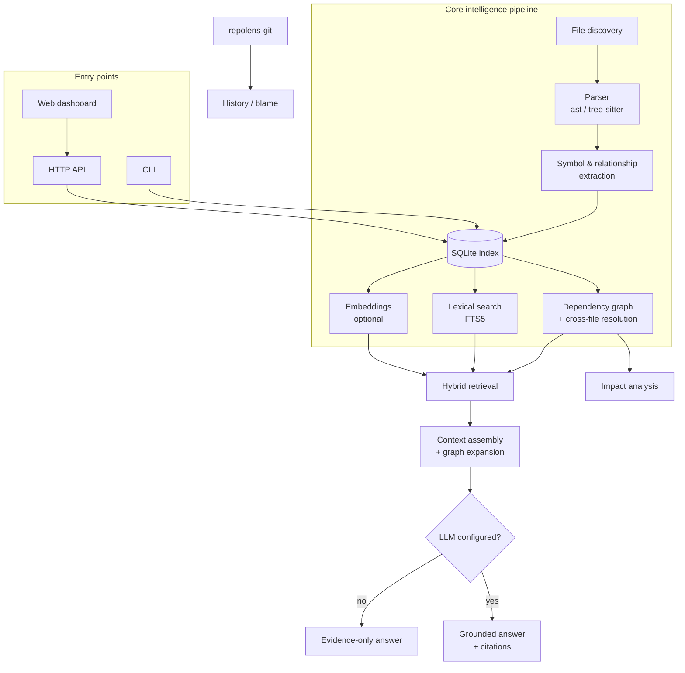

# RepoLens

**Local-first AI codebase intelligence.** RepoLens helps you understand an
unfamiliar repository by actually analyzing it -- parsing, symbol
extraction, a dependency graph, Git history -- and only then, optionally,
using a language model to explain what it found. It runs fully offline by
default; nothing in your repository leaves your machine unless you
explicitly configure a cloud model.

## Why it exists

Most "AI code assistant" tools work the same way: dump some files into an
LLM's context window and hope the model's guess is right. That's fast to
build and easy to fool -- the model can't tell you what it hasn't seen, and
it has no way to distinguish a real dependency from a plausible-sounding
one.

RepoLens inverts that: **understand the repository with real program
analysis first, generate language second.**

- Tree-sitter and Python's `ast` extract real symbols, imports, calls, and
  inheritance -- not an LLM's guess at them.
- A dependency graph, built from that structural data, answers "what
  depends on this?" and "what calls this?" with actual edges, each tagged
  `resolved` or `unresolved` so the system never overstates its own
  confidence.
- Search combines lexical (exact identifiers), semantic (conceptual
  similarity, optional), and structural (graph-based) signals -- not
  vector similarity alone.
- When a question needs natural-language synthesis, the LLM only ever sees
  the specific evidence retrieval found, fenced as data it must cite --
  never the whole repository, and never treated as a source of
  instructions.
- If the evidence isn't there, RepoLens says so instead of inventing an
  answer.

## Features

- **Repository indexing** -- incremental, content-hash-based, respects
  `.gitignore`, never indexes secrets.
- **Code search** -- lexical (FTS5) and, optionally, semantic (embeddings),
  combined with a structural boost when you name a symbol directly.
- **Repository Q&A** -- grounded answers with file:line citations and
  related-symbol context pulled from the dependency graph.
- **Dependency graph** -- file- and symbol-level, with an interactive web
  view (pan/zoom/filter).
- **Impact analysis** -- direct/transitive dependents and related tests for
  a file or symbol, with explicitly stated limitations.
- **Git intelligence** -- real commit history and blame, never invented
  explanations for *why* something changed.
- **CLI, HTTP API, and web dashboard** -- use whichever fits your workflow.
- **Works with zero network access** -- the default provider for both
  search and Q&A is a deterministic, fully local mock; point it at Ollama
  or an OpenAI-compatible endpoint when you want real natural-language
  answers.

## Architecture



Each box on the left is a separate, independently-testable package under
`packages/`; see [`docs/architecture.md`](docs/architecture.md) for the
full breakdown.

## Quick start

Requires Python 3.10+, Node.js 20+, and `git`.

```bash
git clone https://github.com/shrenixcodes/Repolens.git
cd Repolens

python -m venv .venv
source .venv/Scripts/activate   # Windows (git-bash) -- use .venv/bin/activate on macOS/Linux

pip install -e packages/shared -e packages/config -e packages/parser \
            -e packages/indexer -e packages/graph -e packages/retrieval \
            -e packages/ai -e packages/git -e apps/cli

cd /path/to/the/repository/you/want/to/understand
repolens init      # writes a default, fully-offline repolens.yaml
repolens index     # builds the local index
repolens doctor    # sanity-check your environment
```

Now ask it something:

```bash
repolens search "JWT authentication"
repolens ask "Where is authentication implemented?"
repolens impact src/auth/service.py
repolens history src/auth/service.py
```

With no model configured, `ask` still returns real, cited evidence -- it
just says plainly that no language model is set up, instead of faking a
natural-language answer. See [below](#local-model-setup-ollama) to get real
synthesized answers.

## CLI reference

```
repolens init                    # write a default repolens.yaml
repolens index                   # scan + build the local index (incremental)
repolens status                  # index stats: files, symbols, languages
repolens search "<query>"        # lexical search over indexed content
repolens ask "<question>"        # grounded Q&A with citations
repolens impact <file-or-path::symbol>  # dependents, related tests, caveats
repolens history <file>           # real Git commit history for a file
repolens doctor                  # environment diagnostics
```

Every command supports `--repo <path>` (defaults to the current directory)
and `--json` for machine-readable output.

## Local model setup (Ollama)

```yaml
# repolens.yaml
llm:
  provider: ollama
  model: llama3.1          # whatever you've pulled: `ollama pull llama3.1`
embedding:
  provider: ollama
  model: nomic-embed-text
indexing:
  enable_embeddings: true  # semantic search is opt-in
```

No API key, no network access beyond `localhost:11434`. Re-run
`repolens index` after enabling embeddings so existing chunks get vectors.

## Cloud model setup

```yaml
llm:
  provider: openai              # or openai_compatible for self-hosted servers
  model: gpt-4o-mini
embedding:
  provider: openai
  model: text-embedding-3-small
```

```bash
export REPOLENS_LLM_API_KEY=sk-...
export REPOLENS_EMBEDDING_API_KEY=sk-...
```

**Only the specific evidence snippets included in a given answer's context
are sent to the configured provider -- never the whole repository.** See
[`docs/security.md`](docs/security.md) for exactly what that means.
`openai_compatible` works with any server implementing the OpenAI chat/
embeddings API shape (LM Studio, vLLM, text-embeddings-inference, etc.) --
set `base_url` accordingly.

## Web UI

```bash
# Terminal 1
pip install -e apps/api
python -m repolens_api        # http://127.0.0.1:8000

# Terminal 2
cd apps/web
npm install
npm run dev                   # http://localhost:3000
```

Register a repository from the dashboard (or `POST /repositories`), index
it, and use Dashboard / Explorer / Search / Ask / Graph / Impact / History
from the nav bar. See [`apps/web/README.md`](apps/web/README.md).

## Supported languages

| Language | Backend | Status |
|---|---|---|
| Python | stdlib `ast` | classes, functions, methods, imports, calls, inheritance, docstrings, decorators |
| JavaScript / JSX | tree-sitter | classes, functions, methods, imports, calls, inheritance |
| TypeScript / TSX | tree-sitter | the above, plus interfaces, type aliases, `implements` |

Unsupported file types are still indexed (as a single searchable chunk) and
tracked by language `unknown` -- they just don't get symbol/relationship
extraction. See [`packages/parser/README.md`](packages/parser/README.md)
for exact, honestly-stated per-language limitations, and
[`CONTRIBUTING.md`](CONTRIBUTING.md) for how to add a language.

## Supported AI providers

| | LLM | Embeddings |
|---|---|---|
| `mock` (default) | deterministic, offline, discloses it's not a real model | deterministic hash-based vectors |
| `ollama` | ✅ | ✅ |
| `openai` | ✅ | ✅ |
| `openai_compatible` | ✅ (any OpenAI-chat-API-compatible server) | ✅ (any OpenAI-embeddings-API-compatible server) |

## Configuration

`repolens.yaml` in a repository root, layered under environment variables
(`REPOLENS_LLM_PROVIDER`, `REPOLENS_SERVER_PORT`, etc.). Full reference:
[`docs/configuration.md`](docs/configuration.md).

## Development

```bash
pytest                          # all Python package tests
ruff check packages apps        # lint
mypy packages/<name>/src/...    # type check, per package
cd apps/web && npm run lint && npm run build
```

See [`docs/development.md`](docs/development.md) and
[`CONTRIBUTING.md`](CONTRIBUTING.md) for the full setup and workflow.

## Docker

```bash
docker compose up --build
```

Both services bind to `127.0.0.1` only by default. Mount the directory
containing the repositories you want to index -- see the comments in
[`docker-compose.yml`](docker-compose.yml). **Note:** the Docker build was
authored and statically validated (`docker compose config`, and each
image's install/build steps verified directly) but not executed end-to-end
in this project's original development environment -- run
`docker compose up --build` yourself before relying on it in production.

## Security & privacy

- Fully offline by default; a cloud provider is opt-in and documented in
  `repolens.yaml`.
- Every path derived from outside trusted source is validated against its
  expected root before touching disk (no path traversal).
- `.env`, private keys, and the index database are excluded from indexing
  by a hard-coded list that config cannot override.
- Repository content given to an LLM is always fenced as data, never as
  instructions (prompt-injection containment).
- No `shell=True`, no `eval`/`exec`, no unsafe deserialization anywhere in
  the codebase.

Full details: [`docs/security.md`](docs/security.md). Found a
vulnerability? See [`SECURITY.md`](SECURITY.md).

## Known limitations

- Cross-file relationship resolution is a conservative, name-based
  heuristic (see [`packages/graph/README.md`](packages/graph/README.md))
  -- it will not disambiguate dynamic dispatch, reflection, or two symbols
  sharing a name, and src-layout Python packages can throw off absolute-
  import resolution. Ambiguous cases are left `unresolved` rather than
  guessed at.
- Impact analysis does not detect API routes or frontend components
  automatically -- it reports dependency/test evidence and says so.
- No authentication on the API or web UI -- both are built for local,
  single-user use.
- The web UI's dependency graph has not been visually confirmed to render
  edges correctly in every browser -- the underlying data (node/edge
  counts, API response shape) was verified correct; see `PLAN.md` for the
  investigation. If you see nodes but no connecting lines, please open an
  issue with your browser/OS.

## Roadmap

Not yet built, in roughly the order they'd be tackled next:

- Additional languages (Go, Rust, Java -- see the language-support issue
  template).
- Token-level streaming for `ask` (providers currently return a complete
  response in one piece).
- An MCP server exposing RepoLens's tools (`search_code`, `get_dependents`,
  `ask_repository`, ...) to external coding agents.
- VS Code extension.
- Multi-repository workspaces.

## Contributing

See [`CONTRIBUTING.md`](CONTRIBUTING.md). This project follows the
[Code of Conduct](CODE_OF_CONDUCT.md).

## License

[MIT](LICENSE).
